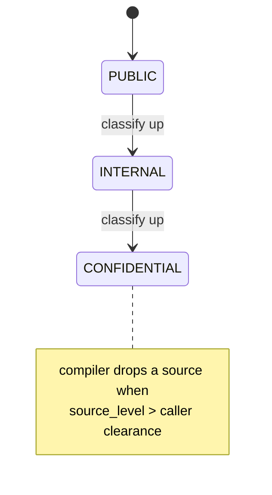

# SPEC-11 — Context Security Classification

> Status: Draft · Last-Reviewed: 2026-06-25 · Depends on: SPEC-00, SPEC-01a
> Owns: data-governance metadata on context provenance; clearance-gated compilation.

## 1. Context

CEMAF tracks *who/why* every context change happened (`ContextPatch` provenance) but not
*how sensitive* the changed data is. The `PriorityContextCompiler` therefore cannot keep a
CONFIDENTIAL datum out of a prompt assembled for a low-clearance call — confidential and
public data are ranked identically.

This spec adds a `SecurityLevel` classification to `ContextPatch` and a clearance gate in the
compiler (CEMAF **core**, additive and backward-compatible). It is a context-engineering
governance feature — classifying and routing context by sensitivity — not an
execution/command-security feature (that is out of CEMAF's scope).



## 2. Interface Contract (MDE)

### 2.1 Core — `cemaf.context.patch`

```python
class SecurityLevel(StrEnum):
    PUBLIC = "public"
    INTERNAL = "internal"        # default — preserves current behavior
    CONFIDENTIAL = "confidential"

    @property
    def rank(self) -> int: ...   # PUBLIC=0 < INTERNAL=1 < CONFIDENTIAL=2

# ContextPatch (frozen dataclass) gains ONE field, defaulted:
#   security_level: SecurityLevel = SecurityLevel.INTERNAL
# to_dict() adds   "security_level": self.security_level.value
# from_dict() reads SecurityLevel(data.get("security_level", "internal"))   # old records OK
```

All `ContextPatch` factory classmethods (`set/delete/merge/append/from_tool/from_agent`)
gain an optional `security_level: SecurityLevel = SecurityLevel.INTERNAL` keyword.

### 2.2 Core — `cemaf.context.compiler.PriorityContextCompiler.compile`

The compiler consumes `(key, content)` tuples, NOT patches — so clearance is threaded
explicitly (it cannot read `ContextPatch.security_level` off the wire):

```python
async def compile(
    self,
    artifacts: tuple[tuple[str, str], ...],
    memories: tuple[tuple[str, str], ...],
    budget: TokenBudget,
    priorities: dict[str, int] | None = None,
    *,
    source_levels: dict[str, SecurityLevel] | None = None,  # key -> level; absent ⇒ INTERNAL
    clearance: SecurityLevel,                               # required; no None / ungated mode
) -> CompiledContext: ...
```

Gate rule: a source whose level `.rank > clearance.rank` is excluded
*before* the priority sort in `PriorityContextCompiler.compile`. Excluded keys are recorded in
`CompiledContext.metadata["security_excluded"]` (provenance, not silent drop).

### 2.3 Classification carriers

The level travels with the content, never in a side map:

- `ContextSource.security_level` (default INTERNAL); every compiler gates on this field.
- `MemoryItem.security_level` (default INTERNAL); persisted by the JSON, SQLite and Postgres stores.
- `MemoryManager.remember(..., security_level=)` and `SessionManager.ingest(..., security_level=)`
  are the labelling entry points; the memory provider passes each memory's level to the compiler.

## 3. Invariants (DbC)

1. `WHEN a ContextPatch is created WITHOUT security_level, THE System SHALL default it to INTERNAL.`
2. `WHEN from_dict reads a record lacking "security_level", THE System SHALL default to INTERNAL` (back-compat with all existing checkpoints).
3. `WHEN clearance admits every level present, THE compiler SHALL select the identical set it selects with no classification` (zero excluded by classification).
4. `IF a source level rank exceeds the caller clearance rank, THEN THE compiler SHALL exclude that source AND record its key under metadata["security_excluded"].`
5. `security_level SHALL NOT alter content_hash determinism` — same content ⇒ same hash regardless of classification.
6. `WHEN a source is derived (with_priority, with_token_count) or compacted into a summary, THE System SHALL keep its level, and a summary SHALL take the most restrictive level it replaces.`
7. `WHEN a MemoryItem is persisted and reloaded, THE System SHALL restore its security_level.`
8. `WHEN session memories are promoted, THE promoted item SHALL keep the session item's level; WHEN they are extracted, THE promoted items SHALL take the most restrictive level among the session memories` (extraction has no per-item provenance).

Budget: 8 invariants.

## 4. Acceptance Criteria (BDD)

```gherkin
Feature: Context security classification

  Scenario: Default classification is INTERNAL
    Given a ContextPatch created without an explicit security_level
    Then its security_level is INTERNAL

  Scenario: Legacy checkpoint round-trips
    Given a serialized patch dict with no "security_level" key
    When it is loaded via from_dict and re-serialized
    Then security_level is INTERNAL and no error is raised

  Scenario: Confidential source excluded under low clearance
    Given an artifact "secrets" classified CONFIDENTIAL and "notes" classified PUBLIC
    When compile runs with clearance=INTERNAL
    Then "notes" is included and "secrets" is in metadata["security_excluded"]

  Scenario: Full clearance admits every level
    Given a CONFIDENTIAL artifact
    When compile runs with clearance=CONFIDENTIAL
    Then the artifact is eligible for selection exactly as before

  Scenario: Confidential memory withheld from internal clearance
    Given a memory remembered with security_level=CONFIDENTIAL
    When the memory provider compiles for clearance=INTERNAL
    Then the memory is not selected and its key is in metadata["security_excluded"]
```

Budget: 5 scenarios.

## 5. Out of Scope

- DataSource-level classification (SPEC-02 territory).
- Encryption / at-rest protection — this is routing metadata, not a crypto boundary.
- Per-field redaction within a source (whole-source gate only).
- Auto-classification of content (levels are set by the producer; inference belongs outside
  this spec).
- **Tool/command risk scoring or execution-security gating** — CEMAF is a context-engineering
  and orchestration substrate, not an execution-security layer. Scoring or blocking concrete
  shell commands belongs in a consumer control plane, not here.

## 6. Dependencies

- SPEC-00 (ContextPatch provenance model), SPEC-01a (PreInterceptor spine — consumer uses it).
- No new third-party dependencies.

## 7. Correctness Properties

### Property 1: Backward compatibility
*For any* persisted patch produced before SPEC-11, loading and re-saving yields an INTERNAL
classification and never raises. **Validates: §3 Inv 2, §4 "Legacy checkpoint round-trips".**

### Property 2: Gate soundness
*For any* source set and clearance C, every source in the compiled output has level rank ≤ C.rank,
and every excluded-by-classification key appears in `security_excluded`.
**Validates: §3 Inv 4, §4 "Confidential source excluded under low clearance".**

### Property 3: Non-interference at full clearance
*For any* inputs, `compile(..., clearance=CONFIDENTIAL)` selects the identical source set as
compiling the same inputs with no classification. **Validates: §3 Inv 3, §4 "Full clearance admits every level".**

Budget: 3 properties.

## 8. Eval Criteria

Not applicable — classification + the clearance gate are deterministic. §3 invariants are the
enforcement.

## 9. Observability Contract

- **Log events** (core compiler): `context.security_excluded` with `{key, source_level, clearance}`.
- **Attributes**: `brightagent.context.security_level`.
- **Metrics**: none (counts derivable from events).

## 10. Test Coverage Update

### a. In-repo layered (cemaf `tests/`)
- **L0 (surface)**: `ContextPatch` round-trip with/without `security_level`; `to_dict/from_dict`
  field presence (§2.1). Compiler `compile` signature accepts new kwargs (§2.2).
- **L2 (behavior)**: gate excludes CONFIDENTIAL under INTERNAL clearance & records key (Inv 4);
  `clearance=CONFIDENTIAL` identical-selection property test (Inv 3); content_hash unchanged by level (Inv 5);
  boundary cases (PUBLIC clearance drops INTERNAL, CONFIDENTIAL sees all, memory gating).
- **Integration** (`tests/integration/test_security_clearance_compilation.py`): the behavioral
  payoff through the real `PriorityContextCompiler` + `GreedySelectionAlgorithm` + `TokenBudget` —
  gating a high-priority CONFIDENTIAL source under tight budget lets a lower-priority INTERNAL
  source take the freed slot (selection *changes*, not just the excluded list); plus
  `security_level` survival across the real `ContextPatch`→`PatchLog` serialize→`from_dict`→replay
  provenance path and `filter_by_source`.

### Self-verification
`cd cemaf && uv run pytest tests/unit/test_context_patch.py tests/unit/test_context_compiler.py tests/integration/test_security_clearance_compilation.py && uv run mypy src/cemaf/context && uv run ruff check`.
Confirm each §2/§3/§4 entry has a test case before opening the PR.
