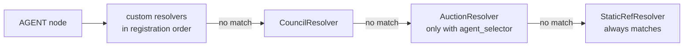

# SPEC-20: Node Resolver Chain

> How `ContextNodeExecutor.execute_node` decides *what* runs for an AGENT node,
> and how an application adds its own node kind. The chain itself shipped as a
> refactor of SPEC-09/SPEC-10 dispatch; this spec records its contract and adds
> the public registration seam (CEMAF-004) that the "adding a node kind is
> registering a resolver" claim depends on.

## 1. Context

`execute_node` walks an ordered tuple of `NodeResolver`s and the first one whose
`matches(node=...)` returns True decides the node (`docs/orchestration.md`
§"Node Resolver Chain"). The chain was built inside `ContextNodeExecutor.__init__`
with no way to add to it: the integration test proving extensibility wrote to
the private `_resolvers` attribute. Applications that want a new node kind (a
human-approval node, a cached-answer node, a tool-only node) had to fork the
executor or reach into private state.



## 2. Interface Contract (MDE)

```python
# existing (orchestration/resolvers/protocols.py) — unchanged
class NodeResolver(Protocol):
    @property
    def resolver_id(self) -> str: ...
    def matches(self, *, node: Node) -> bool: ...
    async def resolve(self, *, node: Node, resolved_inputs: object, run_id: str, start: float) -> ResolveOutcome: ...

# new
@dataclass(frozen=True)
class RuntimeServices:
    node_resolvers: tuple[NodeResolver, ...] = ()

class ContextNodeExecutor:
    def __init__(self, *, ..., node_resolvers: tuple[NodeResolver, ...] = ()) -> None: ...
        # raises ValueError on a duplicate resolver_id across custom + built-in resolvers

def create_executor(*, ..., services: RuntimeServices | None = None) -> DAGExecutor: ...
    # passes services.node_resolvers to ContextNodeExecutor

class ContextNodeExecutor:
    @property
    def resolver_ids(self) -> tuple[str, ...]: ...   # the chain, in match order
```

## 3. Invariants (DbC)

1. `THE chain order SHALL be: custom resolvers in registration order, then CouncilResolver, then AuctionResolver (only when an agent_selector is wired), then StaticRefResolver.`
2. `WHEN a node is executed, THE System SHALL dispatch it to the first resolver whose matches() returns True` and SHALL NOT consult later resolvers.
3. `StaticRefResolver SHALL always be last and SHALL match every node`, so every node resolves.
4. `IF two resolvers in the chain share a resolver_id, THEN THE System SHALL raise ValueError when the executor is constructed.`
5. `WHEN no custom resolvers are registered, THE System SHALL behave exactly as before this spec.`
6. `WHEN a resolver returns NodeComplete, THE System SHALL use that NodeResult as the node's result without running the PRE/POST interceptor chain, RECOVER, agent-directory admission or the per-agent budget charge` — the same path the council takes. Executor-level controls still apply: moderation, events, checkpoints and halts.

Budget: 6 invariants.

## 4. Acceptance Criteria (BDD)

```gherkin
Feature: Node resolver chain

  Scenario: A custom resolver handles its node through create_executor
    Given RuntimeServices(node_resolvers=(approval_resolver,))
    And a DAG with a node whose config marks it as an approval node
    When the DAG runs through create_executor
    Then approval_resolver produces that node's result
    And the node's ref_id agent never runs

  Scenario: A custom resolver that does not match falls through
    Given the same executor
    And an ordinary AGENT node
    When the DAG runs
    Then the node runs its ref_id agent

  Scenario: Custom resolvers come before the built-ins
    Given a custom resolver that matches council nodes
    When a council node runs
    Then the custom resolver handles it and no council deliberation happens

  Scenario: Duplicate resolver ids are rejected
    Given two custom resolvers with the same resolver_id
    When the executor is constructed
    Then a ValueError names the duplicate id

  Scenario: The chain is inspectable
    Given RuntimeServices(node_resolvers=(approval_resolver,))
    When resolver_ids is read
    Then it lists the custom resolver, council, auction only when an agent_selector is wired, then StaticRefResolver

  Scenario: A custom resolver's output is still moderated
    Given a custom resolver whose NodeComplete output contains a blocked word
    And a moderation pipeline that blocks that word
    When the DAG runs
    Then the node fails and its output never reaches the context
```

Budget: 6 scenarios.

## 5. Out of Scope

- Per-node or per-run resolver chains — the chain is fixed per executor.
- Resolvers for non-AGENT node types (PARALLEL, LOOP, CONDITIONAL, ROUTER keep
  their own handlers in `node_handlers.py`).
- Reordering or removing the built-in resolvers.
- Running interceptors (e.g. `GateEvalInterceptor`) on `NodeComplete` results. A
  resolver that produces its own result owns its quality and should check it
  inside `resolve()`.

## 6. Dependencies

- SPEC-09 (`AuctionResolver`), SPEC-10 (`CouncilResolver`).
- `cemaf.orchestration.resolvers.protocols.NodeResolver`, `RunAgent`, `NodeComplete`.

## 7. Correctness Properties

### Property 1: Every node resolves exactly once

*For any* AGENT node and any registered chain, exactly one resolver's
`resolve()` runs for that node, and it is the first in chain order whose
`matches()` is True.

**Validates: §3 Invariants 1, 2, 3; §4 Scenarios "A custom resolver handles its node through create_executor", "Custom resolvers come before the built-ins"**

## 10. Test Coverage Update

- **Integration** (`tests/integration/test_resolver_chain.py`): every §4 scenario
  through the public `node_resolvers` seam — no private attribute access —
  including duplicate-id rejection (custom and built-in ids) and the full
  `resolver_ids` order with and without an `agent_selector`.
