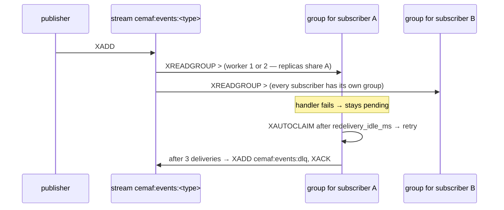

# SPEC-24: Durable Event Bus Delivery

> `RedisEventBus` is the multi-process `EventBus`. It must deliver every event to
> every subscriber, survive restarts, and retry failing handlers until a
> dead-letter stream takes the message.

## 1. Context

`RedisEventBus` had no test of any kind. Against a real Redis two promises in its
docstring failed:

- **Fan-out.** Every subscriber to a type shared one consumer group
  (`group-<type>`), so two subscribers split the events between them — each saw
  only some of them.
- **Retry and dead-letter.** A failed message stayed pending, but the loop only
  read new messages (`>`), so it was never redelivered, its delivery count never
  reached the limit, and it never reached `cemaf:events:dlq`.



## 2. Interface Contract (MDE)

```python
class RedisEventBus:
    def __init__(self, redis_url: str, worker_id: str | None = None,
                 max_stream_length: int = 100_000, redelivery_idle_ms: int = 60_000) -> None: ...
    def subscribe(self, event_type: str | EventType, handler: EventHandler | EventHandlerFn,
                  *, subscriber_name: str | None = None) -> Callable[[], None]: ...
    def subscribe_all(self, handler: EventHandler | EventHandlerFn,
                      *, subscriber_name: str | None = None) -> Callable[[], None]: ...
# Consumer group = "group-<type>-<subscriber_name>"; subscriber_name defaults to the
# handler's module-qualified name, so it is stable across restarts. Lambdas and
# functools.partial have shared names and raise ValueError unless subscriber_name is
# given. A second, different handler resolving to the same group on one bus raises
# ValueError too (this covers two closures from one factory). Requires Redis 6.2+.
```

**Choosing `redelivery_idle_ms`.** Redis measures idle time from delivery, not from
when a handler finishes. A value shorter than the slowest handler lets another
replica claim a message that is still being handled, which re-runs it and spends
one of its three delivery attempts. The 60 s default favours correctness; lower
it only for handlers known to be fast.

**Upgrading from `group-<type>`.** Earlier versions used one group per type. New
group names start reading each stream from the beginning, so the first deploy
replays retained history (up to `max_stream_length` per type) to every subscriber,
and the old groups keep their unacknowledged messages. Trim streams or delete the
old groups (`XGROUP DESTROY`) before upgrading if replay is unwanted.

## 3. Invariants (DbC)

1. `WHEN two subscribers with different names subscribe to one type, THE System SHALL deliver every event of that type to both.`
2. `WHEN replicas subscribe with the same name, THE System SHALL deliver each event to exactly one of them` (one group, competing consumers).
3. `WHEN a handler fails, THE System SHALL redeliver the message after redelivery_idle_ms`, and `WHEN it has been delivered 3 times without success, THE System SHALL move it to cemaf:events:dlq and acknowledge it.`
4. `A subscriber that starts after an event was published SHALL still receive it` (its group reads the stream from the start).
5. `IF a subscriber name cannot be derived uniquely (lambda, partial), THEN subscribe SHALL raise ValueError`, and `IF a name already belongs to a different handler on the same bus, THEN subscribe SHALL raise ValueError.`
6. `THE reclaim scan SHALL resume from Redis's cursor`, so every pending message is eventually considered, however long the pending list.

Budget: 6 invariants.

## 4. Acceptance Criteria (BDD)

```gherkin
Feature: Durable event bus

  Scenario: Delivery
    Given a subscriber to "t"
    When an event of type "t" is published
    Then the subscriber receives it

  Scenario: Fan-out
    Given two subscribers to "t" with different handlers
    When two events are published
    Then each subscriber receives both

  Scenario: Late subscriber
    Given an event of type "t" was published
    When a subscriber to "t" starts
    Then it receives the event

  Scenario: Replicas split the work
    Given two buses subscribing different handlers under the name "indexer"
    When 20 events are published
    Then each event is handled exactly once across the two

  Scenario: Ambiguous or reused names are refused
    When a lambda subscribes without subscriber_name
    Or a second handler subscribes under a name already in use on the bus
    Then subscribe raises ValueError

  Scenario: Dead letter
    Given a subscriber whose handler always fails
    When an event is published
    Then the handler is tried 3 times and the event lands in cemaf:events:dlq
```

## 5. Out of Scope

- Ordering guarantees across event types.
- Replaying the dead-letter stream.

## 10. Test Coverage Update

- **Integration** (`tests/integration/test_redis_event_bus_live.py`): all §4
  scenarios against a real Redis (CI: `redis:7-alpine` service container).
