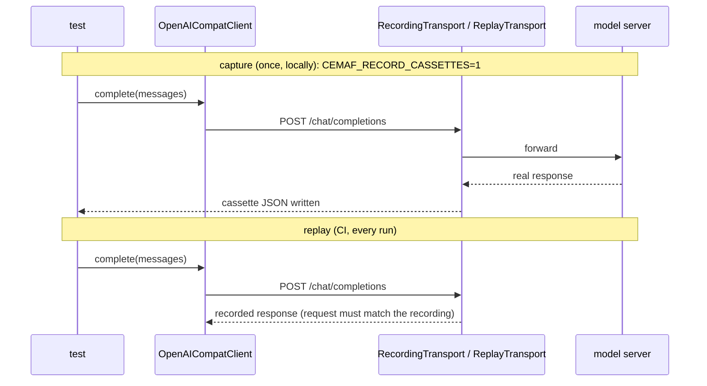

# SPEC-25: Recorded LLM Replay

> No test in the default suite talked to a real model. This spec adds the seam and
> the cassette format so a real model call is captured once and replayed in CI
> through the real adapter — the response shape is what the model actually sent.

## 1. Context

`OpenAICompatClient` (the client behind `create_ollama_client`, OpenAI, Groq,
vLLM, …) built its `httpx.AsyncClient` internally, so a test could only stand in
for the model by monkeypatching, which hides real parsing bugs. The live Ollama
tests are opt-in and never run in CI.



## 2. Interface Contract (MDE)

```python
class OpenAICompatClient:
    def __init__(self, *, ..., transport: httpx.AsyncBaseTransport | None = None) -> None: ...
    # None = httpx's default network transport. Both complete() and stream() use it.

def create_ollama_client(*, ..., transport: httpx.AsyncBaseTransport | None = None) -> LLMClient: ...

# tests/cassettes/<name>.json — one recorded exchange
{
  "recorded_with": {"provider": "ollama", "model": "qwen2.5:7b"},
  "request":  {"method": "POST", "path": "/v1/chat/completions", "json": {...}},
  "response": {"status": 200, "json": {...}}
}
```

## 3. Invariants (DbC)

1. `WHEN a transport is passed, THE System SHALL send every request of complete() and stream() through it.`
2. `A cassette SHALL hold only what the model server returned`; it is never hand-edited, and contains no API keys or auth headers.
3. `WHEN replaying, IF the adapter's request body differs from the recorded one, THEN THE test SHALL fail` — a change to the wire request is caught, not silently answered.
4. `THE replayed response SHALL be parsed by the production adapter code path`, with no test-only parsing.

Budget: 4 invariants.

## 4. Acceptance Criteria (BDD)

```gherkin
Feature: Recorded LLM replay

  Scenario: Replaying a captured Ollama completion
    Given the cassette captured from qwen2.5:7b
    When create_ollama_client(transport=replay) completes the recorded prompt
    Then the result succeeds with the recorded text and non-zero token usage

  Scenario: A changed request is caught
    Given the same cassette
    When the client sends a different prompt
    Then the replay transport raises and the test fails

  Scenario: Capturing a cassette
    Given CEMAF_RECORD_CASSETTES=1 and a local Ollama with qwen2.5:7b
    When the replay test runs
    Then it calls the real model and rewrites the cassette
```

## 5. Out of Scope

- Anthropic's SDK client (it takes its own `http_client`; its prompt-caching test
  already replays over `httpx.MockTransport`).
- Streaming cassettes.
- Judging answer quality — the test proves the adapter against the real wire shape.

## 10. Test Coverage Update

- **Integration** (`tests/integration/test_llm_recorded_replay.py`): all §4 scenarios.
  The cassette lives in `tests/cassettes/`.
