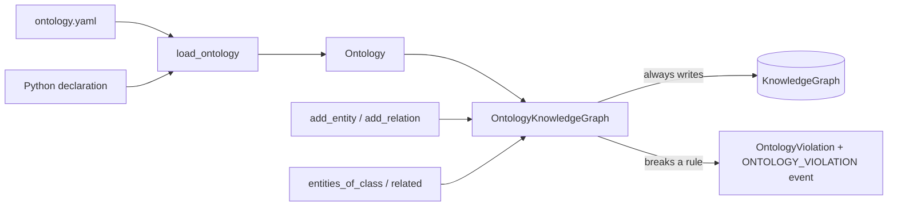

# SPEC-27: Knowledge Ontologies

> An ontology tells CEMAF what a knowledge base is *about*: which kinds of things
> exist, what they carry, how they may relate, and which rules the knowledge
> should obey. It turns the knowledge graph (KG) from CEMAF's self-model into an
> engine for any domain's knowledge base.

## 1. Context

The knowledge graph accepts only a fixed vocabulary: `EntityType` (`agent`, `tool`,
`dag`, `run`, `module`, `protocol`, `skill`, `concept`) and `RelationType` (`uses`,
`produces`, `depends_on`, …). That vocabulary describes CEMAF itself. Another
domain's knowledge base — *a Service is owned by a Team*, *a Document is written by
an Author* — cannot be expressed, checked, or queried by meaning.

An **ontology** is a versioned, declared vocabulary for one knowledge base:

- **classes** — kinds of things, with single inheritance (`Engineer is_a Person`);
- **properties** — named, typed attributes a class carries, optionally required or
  limited to allowed values; subclasses inherit them;
- **relations** — named links with a source class and a target class
  (`owns: Team → Service`) and optional cardinality limits.

Enforcement is **advisory**: knowledge that breaks the ontology is still written,
and every break is recorded as an `OntologyViolation` and published as an event.
Messy real-world extraction keeps flowing; the violations show where it is wrong.

CEMAF's own vocabulary becomes one ontology, `cemaf-self`, so the self-hosting
layer runs on the same machinery as any other knowledge base.



## 2. Interface Contract (MDE)

```python
class PropertyType(StrEnum):
    STRING; INTEGER; NUMBER; BOOLEAN; DATE; DATETIME

@dataclass(frozen=True, slots=True)
class PropertySpec:
    type: PropertyType
    required: bool = False
    allowed: tuple[str, ...] = ()          # empty = any value of the type
    description: str = ""

@dataclass(frozen=True, slots=True)
class OntologyClass:
    name: str
    is_a: str | None = None
    properties: Mapping[str, PropertySpec]
    description: str = ""

@dataclass(frozen=True, slots=True)
class RelationSpec:
    name: str
    source: str                             # class name; subclasses also qualify
    target: str
    max_per_source: int | None = None       # e.g. a Service has at most 1 owning Team
    description: str = ""

@dataclass(frozen=True, slots=True)
class Ontology:
    name: str
    version: int
    classes: Mapping[str, OntologyClass]
    relations: Mapping[str, RelationSpec]
    def ancestors(self, *, class_name: str) -> tuple[str, ...]: ...      # nearest first
    def is_a(self, *, class_name: str, ancestor: str) -> bool: ...
    def properties_of(self, *, class_name: str) -> Mapping[str, PropertySpec]: ...  # inherited + own
    def validate_entity(self, *, entity: KGEntity) -> tuple[OntologyViolation, ...]: ...
    def validate_relation(self, *, relation: KGRelation, source: KGEntity | None,
                          target: KGEntity | None, existing_from_source: int) -> tuple[OntologyViolation, ...]: ...

class ViolationKind(StrEnum):
    UNKNOWN_CLASS; MISSING_PROPERTY; UNKNOWN_PROPERTY; WRONG_PROPERTY_TYPE; VALUE_NOT_ALLOWED
    UNKNOWN_RELATION; WRONG_SOURCE_CLASS; WRONG_TARGET_CLASS; MISSING_ENDPOINT; TOO_MANY_RELATIONS

@dataclass(frozen=True, slots=True)
class OntologyViolation:
    kind: ViolationKind
    subject_id: str                         # entity id, or "source->target:relation"
    message: str

def load_ontology(*, path: Path) -> Ontology: ...          # YAML or JSON; raises OntologyDefinitionError
def ontology_from_mapping(*, data: Mapping[str, object]) -> Ontology: ...

class OntologyDefinitionError(ValueError): ...             # the ontology itself is malformed

class OntologyKnowledgeGraph:                               # implements KnowledgeGraph
    def __init__(self, *, graph: KnowledgeGraph, ontology: Ontology,
                 event_bus: EventBus | None = None) -> None: ...
    @property
    def ontology(self) -> Ontology: ...
    def violations(self) -> tuple[OntologyViolation, ...]: ...
    async def entities_of_class(self, *, class_name: str, include_subclasses: bool = True) -> tuple[KGEntity, ...]: ...
    async def related(self, *, entity_id: str, relation: str) -> tuple[KGEntity, ...]: ...
    # every KnowledgeGraph method delegates to `graph`; writes validate first, then always write.

CEMAF_SELF_ONTOLOGY: Ontology   # classes = EntityType values, relations = RelationType values

KGEntity.type: str              # was EntityType; EntityType (a StrEnum) still fits as a class name
KGRelation.type: str            # was RelationType

EventType.ONTOLOGY_VIOLATION    # payload: {"ontology", "version", "kind", "subject_id", "message"}
```

YAML form (the same structure `ontology_from_mapping` accepts):

```yaml
ontology: service-catalog
version: 1
classes:
  Person:
    properties:
      name: {type: string, required: true}
  Engineer: {is_a: Person}
  Team:
    properties:
      name: {type: string, required: true}
  Service:
    properties:
      tier: {type: string, required: true, allowed: [critical, standard, experimental]}
relations:
  member_of: {from: Engineer, to: Team}
  owns: {from: Team, to: Service}
  on_call_for: {from: Engineer, to: Service, max_per_source: 3}
```

## 3. Invariants (DbC)

1. `IF an ontology declares is_a to an unknown class, an inheritance cycle, a relation endpoint that is not a class, or a duplicate name, THEN load SHALL raise OntologyDefinitionError` naming the problem.
2. `properties_of(C) SHALL be C's own properties plus every ancestor's`; a subclass may not redeclare an inherited property with a different type.
3. `is_a(C, C) SHALL be True`, and `is_a` SHALL be transitive along `is_a` links.
4. `WHEN an entity or relation is written through OntologyKnowledgeGraph, THE System SHALL write it to the underlying graph whatever its violations` (advisory).
5. `WHEN a write breaks the ontology, THE System SHALL record one OntologyViolation per broken rule and, if an event bus is set, publish ONTOLOGY_VIOLATION for each.`
6. `A write that satisfies the ontology SHALL produce no violation and no event.`
7. `A relation's source and target SHALL qualify through inheritance`: an Engineer satisfies `from: Person`.
8. `WHEN a source already has max_per_source relations of a type, THE next one SHALL be a TOO_MANY_RELATIONS violation.`
9. `entities_of_class(C, include_subclasses=True) SHALL return entities of C and of every descendant of C.`
10. `CEMAF_SELF_ONTOLOGY SHALL accept every entity and relation the meta layer writes today` — the self-hosting layer produces no violations.
11. `THE ontology SHALL be immutable`; a changed ontology is a new version.

Budget: 11 invariants.

## 4. Acceptance Criteria (BDD)

```gherkin
Feature: Knowledge ontologies

  Scenario: Load an ontology from YAML
    Given the service-catalog YAML above
    When it is loaded
    Then Engineer is_a Person and Engineer has the required property "name"

  Scenario: A malformed ontology is refused
    Given an ontology where Engineer is_a Engineer
    When it is loaded
    Then OntologyDefinitionError names the inheritance cycle

  Scenario: A valid write is quiet
    Given a Service with tier "critical"
    When it is written
    Then it is stored and no violation is recorded

  Scenario: A missing required property is recorded, not rejected
    Given a Service with no tier
    When it is written
    Then it is stored and a MISSING_PROPERTY violation is recorded and published

  Scenario: A value outside the allowed list is recorded
    Given a Service with tier "legendary"
    When it is written
    Then a VALUE_NOT_ALLOWED violation is recorded

  Scenario: A relation between the wrong classes is recorded
    Given a Service and a Team
    When "owns" is written from the Service to the Team
    Then WRONG_SOURCE_CLASS and WRONG_TARGET_CLASS are recorded

  Scenario: Cardinality is checked
    Given an Engineer already on call for 3 Services
    When a 4th "on_call_for" relation is written
    Then a TOO_MANY_RELATIONS violation is recorded

  Scenario: Querying a class includes its subclasses
    Given a Person and an Engineer
    When entities_of_class("Person") runs
    Then both are returned

  Scenario: Walking a typed relation
    Given a Team that owns two Services
    When related(team, "owns") runs
    Then both Services are returned

  Scenario: CEMAF's own knowledge fits its ontology
    Given the meta layer's knowledge refresh over a real run
    When it writes to an OntologyKnowledgeGraph bound to CEMAF_SELF_ONTOLOGY
    Then no violation is recorded
```

Budget: 10 scenarios.

## 5. Out of Scope

- **Agent use of ontologies** — extraction guided by the ontology, and ontology-labelled
  context for agents — is SPEC-28, built on this spec.
- Importing OWL / RDF / SHACL / schema.org (a later adapter producing an `Ontology`).
- Multiple inheritance, reasoning beyond `is_a`, and rules across more than one relation.
- Strict (rejecting) enforcement.
- Migrating stored knowledge between ontology versions.

## 6. Dependencies

- `cemaf.knowledge.protocols.KnowledgeGraph`, `KGEntity`, `KGRelation` (SPEC-02/07).
- `cemaf.events` for `ONTOLOGY_VIOLATION`.
- `pyyaml` (already in the `okf` extra) for YAML loading; JSON needs nothing extra.

## 7. Correctness Properties

### Property 1: Advisory never loses knowledge
*For any* ontology and any write, the underlying graph receives the write.
**Validates: §3 Invariant 4; §4 "A missing required property is recorded, not rejected"**

### Property 2: Violations are exactly the broken rules
*For any* entity, the recorded violations are exactly the rules it breaks: none for a
conforming entity, one per broken rule otherwise.
**Validates: §3 Invariants 5, 6; §4 "A valid write is quiet", "A value outside the allowed list"**

### Property 3: Inheritance is consistent
*For any* class C with ancestor A: `is_a(C, A)`, `properties_of(C) ⊇ properties_of(A)`,
and every C entity is returned by `entities_of_class(A)`.
**Validates: §3 Invariants 2, 3, 7, 9**

## 9. Observability Contract

- **Event**: `ONTOLOGY_VIOLATION` with `{ontology, version, kind, subject_id, message}`.
- **Log**: `ontology.violation` at INFO per violation; `ontology.loaded` with class and
  relation counts.

## 10. Test Coverage Update

- **Unit** (`tests/unit/knowledge/test_ontology.py`): loading, definition errors,
  inheritance, every `ViolationKind`, property-based inheritance checks (Property 3).
- **Integration** (`tests/integration/test_ontology_knowledge_graph.py`): §4 scenarios
  through a real `MemoryBackedKnowledgeGraph` and `InMemoryEventBus`, including the
  `cemaf-self` scenario over a real meta-layer knowledge refresh.
